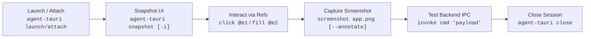

# Agent Tauri Automation Skill

`agent-tauri` brings the capabilities of browser automation tools (like `agent-browser` and Playwright) directly to desktop Tauri applications. It provides a token-efficient accessibility snapshot tree with interactive reference tags (`@e1`, `@e2`, ...), visual badge screenshot annotations, and direct Tauri IPC bridges.

---

## When to Use This Skill

Activate this skill when:
- Testing or interacting with a running or packaged Tauri application (`.exe`, AppImage, `.dmg`, or `cargo tauri dev`).
- Inspecting UI state without blowing LLM context windows on raw DOM trees.
- Executing user actions: clicking buttons, filling text inputs, checking boxes, selecting dropdowns, and scrolling.
- Capturing screenshots (full-window, element-targeted, or annotated with visual ref badges).
- Testing Tauri IPC backend commands (`invoke`) or inspecting frontend console output.

---

## Core Workflow



### Step 1: Launch or Attach to the Tauri App

#### Option A: Launching directly
```bash
# Launch a compiled binary
npx agent-tauri launch ./src-tauri/target/release/my-app.exe

# Or launch development mode
npx agent-tauri launch "cargo tauri dev"
```
*Note: On Windows, `agent-tauri` automatically injects `WEBVIEW2_ADDITIONAL_BROWSER_ARGUMENTS="--remote-debugging-port=9222"` so the WebView2 engine opens Chrome DevTools Protocol (CDP).*

#### Option B: Attaching to an already running app
If your app is already started with remote debugging enabled:
```bash
npx agent-tauri attach --port 9222
```

Check connection status anytime:
```bash
npx agent-tauri status
```

---

### Step 2: Snapshot the UI State

Generate a compact, token-efficient view of the current screen:

```bash
# Compact snapshot of interactive elements (Recommended for AI agents)
npx agent-tauri snapshot -i

# Full snapshot including semantic headings and text blocks
npx agent-tauri snapshot
```

Example Snapshot Output:
```text
Window: "My Tauri App" (http://tauri.localhost/)
------------------------------------------------------------
  - [@e1] [h1] "Tauri Todo & Greet"
  - [@e2] [label] "Name:"
  - [@e3] [input] placeholder="Enter name..." value=""
  - [@e4] [button] "Greet"
  - [@e5] [div] "No greeting yet"
  - [@e6] [checkbox] "I agree" (checked=false)
  - [@e7] [select] "Low High" (value="low")
```

---

### Step 3: Interact with UI Elements Using Refs

Use the `@eX` reference markers obtained from the snapshot to interact reliably:

```bash
# Fill an input field
npx agent-tauri fill @e3 "Alice Smith"

# Click a button
npx agent-tauri click @e4

# Check or uncheck a checkbox
npx agent-tauri check @e6
npx agent-tauri uncheck @e6

# Select option from a dropdown
npx agent-tauri select @e7 "high"

# Type without clearing or press specific keyboard keys
npx agent-tauri type @e3 " - Admin"
npx agent-tauri press Enter

# Hover or focus
npx agent-tauri hover @e4
npx agent-tauri focus @e3

# Scroll page or container
npx agent-tauri scroll down 400
```

---

### Step 4: Verify with Screenshots

```bash
# Take a standard window screenshot
npx agent-tauri screenshot ./evidence.png

# Take a full-page scroll screenshot
npx agent-tauri screenshot ./evidence.png --full

# Take an annotated screenshot (renders red bounding boxes & @ref badges)
npx agent-tauri screenshot ./annotated.png --annotate

# Screenshot a specific element
npx agent-tauri screenshot ./element.png --target @e4
```

---

### Step 5: Test Tauri Backend IPC & JavaScript

Tauri apps combine a frontend webview with a native Rust backend. `agent-tauri` lets you test both:

```bash
# Directly invoke a Rust backend command
npx agent-tauri invoke greet '{"name": "Alice"}'
npx agent-tauri invoke get_app_version '{}'

# Evaluate JavaScript in the webview
npx agent-tauri eval "window.location.href"
npx agent-tauri eval "document.title"

# Retrieve element text or attribute
npx agent-tauri get text @e5
npx agent-tauri get attr @e3 placeholder
npx agent-tauri get value @e3
```

---

### Step 6: Inspect Logs & Multi-Window Management

```bash
# View captured webview console logs (log, warn, error)
npx agent-tauri console
npx agent-tauri console --clear

# Multi-window support (e.g. settings dialog or secondary window)
npx agent-tauri windows
npx agent-tauri switch-window 1
```

---

### Step 7: Clean Up

Always terminate the session when done:
```bash
npx agent-tauri close
```

---

## Detailed References

For advanced topics and platform specifications:
- [CLI Command Full Reference](./references/cli-reference.md)
- [Tauri Architecture & IPC Internals](./references/tauri-architecture.md)
- [Cross-Platform Guidelines (Windows, macOS, Linux)](./references/cross-platform.md)
- [Example: Login & Form Automation](./examples/login-and-form.md)
- [Example: Testing Backend IPC & State](./examples/ipc-and-state.md)
